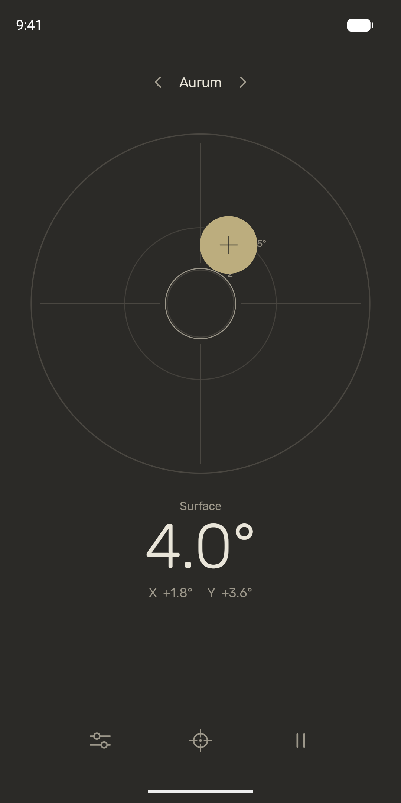
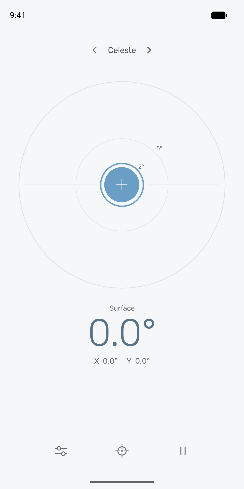
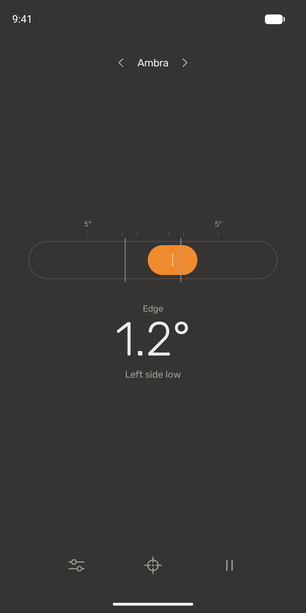
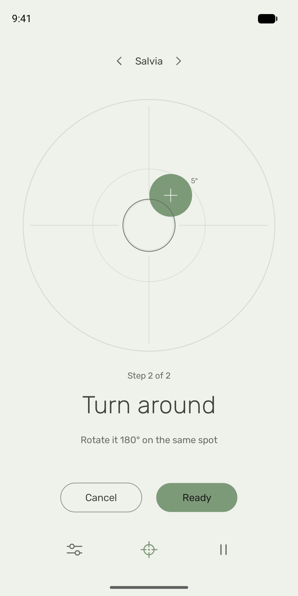
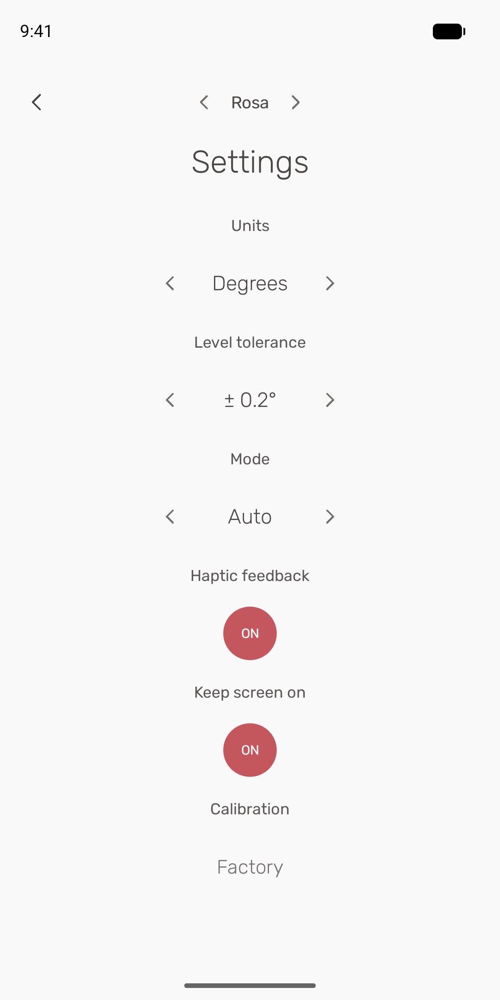

# Bubble Level – Spot On

A calm bubble level for Android: flat colour, hairlines, one accent, a circle motif, a centred
column, and named themes switched from the header. No ads, no tracking, no internet permission.

  
  
  
  
  

Android 6.0 (API 23) and later. Download the APK from
[Releases](https://github.com/saatvik333/level-android/releases);
[privacy policy](https://saatvik333.github.io/level-android/privacy).

## Build

Gradle-free: aapt2 → javac → R8 → bundletool. Needs the Android SDK (`build-tools;36.0.0`,
`platforms;android-36`, `cmdline-tools;latest`), JDK 17+, [bundletool](https://github.com/google/bundletool),
python3 with Pillow, and zip.

    ./build.sh                     # build/Level.aab (Play), build/Level.apk (universal), build/mapping.txt
    NEW_KEYSTORE=1 ./build.sh      # first build on a machine without the upload key: creates one

The upload key lives outside the repository at `~/.local/share/level-android/upload.jks` (`KEYSTORE`
overrides it). Its password comes from `KEYSTORE_PASS` or the desktop keyring
(`secret-tool lookup service level-android key upload-keystore`). `VERSION_CODE` / `VERSION_NAME`
override the version; every Play upload needs a higher `VERSION_CODE`.

Publishing on Google Play, with every Play Console answer: [docs/play-console.md](docs/play-console.md).
Store text and graphics live in `fastlane/metadata/android/en-US/`; `tools/store_screenshots.sh`
recaptures the screenshots from an emulator, `tools/make_feature_graphic.py` redraws the feature graphic.

## Layout

    src/me/saatvik/level/
      LevelEngine.java   sensor math, adaptive filter, mode hysteresis, two-step reversal calibration (no Android deps)
      Renderer.java      all drawing, android.graphics only
      LevelView.java     animation (spring bubble, theme/page/mode crossfades), input, haptics
      MainActivity.java  sensors, window/insets, predictive back, Material You palette on 12+
      Palette.java       theme tokens: bg, fg, dim, line, accent, onAccent
    tools/preview/       AWT-backed android.graphics stubs: renders Renderer on the JVM; EngineTest

    javac -d /tmp/pv $(find tools/preview -name '*.java') src/me/saatvik/level/{Palette,Ui,Renderer,LevelEngine}.java
    java -cp /tmp/pv me.saatvik.level.EngineTest
    java -Djava.awt.headless=true -cp /tmp/pv me.saatvik.level.Preview assets/fonts /tmp/shots

## Behaviour

- Surface mode (bullseye) when the screen is within 40° of horizontal, edge mode (tube) beyond 50°.
  Edge mode rotates the instrument to the nearest 90° so the tube stays world-horizontal.
- Calibration: place, capture; turn 180° about the vertical (gyro-detected, or tap Ready); capture.
  The two readings cancel the surface slope and leave the sensor offset, so any firm surface works.
  With a gyroscope the measured turn angle is used, so an imprecise turn still solves exactly.
  Surface and edge offsets are calibrated and applied separately (a camera bump or an edge has its
  own geometry). Calibration is stored outside backups: it never moves to another phone.
- Tap the instrument or the pause icon to hold the reading. Swipe sideways to change theme.
- Every control is exposed to TalkBack and Switch Access as a virtual node.

## Credits

Visual style inspired by Dustland Design's *The Clean One* games; not affiliated with or endorsed by
Dustland Design.

Rubik is bundled under the SIL Open Font License (assets/fonts/OFL.txt).
